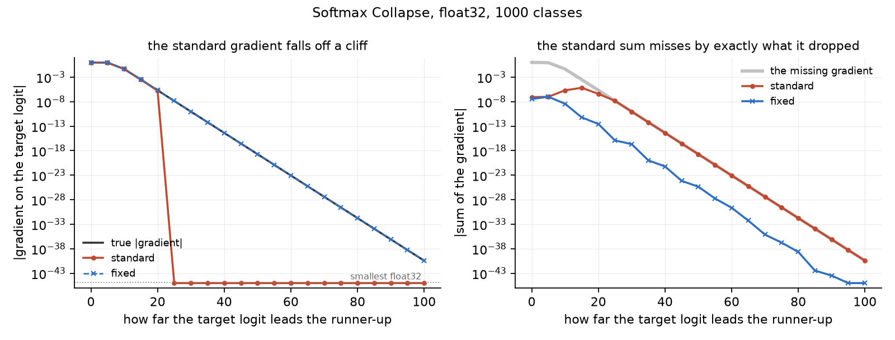
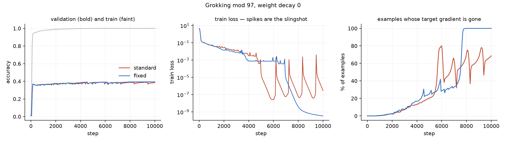
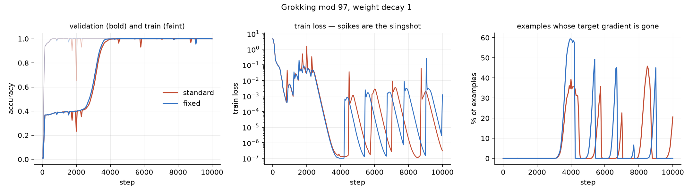

<h1 align="center">softmax-fix</h1>

<p align="center">
  <a href="https://github.com/tatra-labs/softmax-fix/actions/workflows/tests.yml"></a>
  <a href="https://arxiv.org/abs/2610.31642"></a>
  <a href="LICENSE"></a>
</p>

<p align="center"><b>Your cross-entropy throws away the target's gradient, and it is not even close.</b><br>
Once the right answer leads the runner-up by 25 nats, PyTorch returns exactly <code>0.0</code> for the one
gradient that matters — while float32 could have carried it another 75 nats.</p>

```python
import torch, torch.nn.functional as F

logits = torch.zeros(1, 1000); logits[0, 0] = 40.0     # the target wins by 40
logits.requires_grad_(True)
torch.autograd.grad(F.cross_entropy(logits, torch.tensor([0])), logits)[0][0, 0]
# tensor(0.)          <- the true value is -4.24e-15, which float32 holds comfortably
```

[*A Fix for Softmax and Cross-Entropy*](https://arxiv.org/abs/2610.31642) (Barron, Gnanapragasam
and Tschannen, October 2026) names two numerical bugs in the standard implementations and reports
that fixing them removes the slingshot phenomenon, speeds up grokking, prevents accuracy collapse
without weight decay, and stops students drifting from their teachers. No code was released.

**softmax-fix** is a dependency-free implementation of those fixes, the measurements that show the
bugs are real, and the training runs that show what they cost.

```bash
pip install -e ".[dev,experiments]"
python experiments/numerics.py        # the two bugs, no training needed, seconds
pytest -q                             # 26 tests
```

```python
from softmax_fix import cross_entropy          # drop-in for F.cross_entropy
loss = cross_entropy(logits, targets)
```

## Bug one: the target's gradient disappears

The usual route to a cross-entropy gradient builds the probability vector and subtracts the one-hot
target, `grad = p - y`. When one logit dominates, `p[target]` rounds to exactly `1.0`, so
`grad[target]` becomes exactly `0.0`. The true value is `-(1 - p[target])`, and *that* number stays
perfectly representable long after `1 - p` has stopped being.

| target's lead | standard gradient | fixed | true value | float32 can hold it |
|---:|---:|---:|---:|:--:|
| 0 | -9.990e-01 | -9.990e-01 | -9.990e-01 | yes |
| 10 | -4.339e-02 | -4.339e-02 | -4.339e-02 | yes |
| 20 | -1.669e-06 | -2.059e-06 | -2.059e-06 | yes |
| 25 | **0.000e+00** | -1.387e-08 | -1.387e-08 | yes |
| 40 | **0.000e+00** | -4.244e-15 | -4.244e-15 | yes |
| 60 | **0.000e+00** | -8.748e-24 | -8.748e-24 | yes |
| 80 | **0.000e+00** | -1.803e-32 | -1.803e-32 | yes |
| 100 | **0.000e+00** | -3.780e-41 | -3.780e-41 | yes |

<sub>float32, 1000 classes. "Lead" is the target logit minus the runner-up. `python experiments/numerics.py`</sub>

The standard gradient is **exactly zero from a lead of 25 onwards, while float32 carries the true
value all the way to 100** — the fixed version tracks it across forty orders of magnitude. This is
not a rounding error, it is a missing term.



And it is not a harmless one. A softmax gradient must sum to zero; the right-hand panel shows the
standard gradient missing that by *exactly* the amount it dropped. Every non-target logit is pushed
down with nothing pushing the target back up, which is a net force on the logits that should not
exist.

### The fix

Never form `1 - p`. Work relative to the target:

```
d = z - z[target]                       so d[target] is exactly 0
grad[target] = -(sum of the other probabilities)
```

The target's gradient becomes a sum of positive terms instead of a cancelling subtraction, it is
exact for as long as any other probability is representable, and the gradient sums to zero by
construction. The loss follows the same route — `-log p[target]` is `log1p(sum of the others)` —
which is why `target_log_prob` still returns `-1.93e-20` where `torch.log_softmax` returns `0.0`.

One thing this does **not** fix, and cannot: `softmax` itself. Past a ~17-nat lead the winning
probability is not representable as anything but `1.0` in float32, whatever you do. The information
is gone from `p` and still present in `log p`, which is exactly why the gradient here never goes
through `p` at all.

## Bug two: a student that has already caught up keeps being pushed

The gradient of a distillation loss is `p_student - p_teacher`. Computed that way it is a
subtraction of two nearly-equal vectors, so when the student has matched the teacher, whatever
rounding separates them *is* the gradient. Teacher probabilities cached in bfloat16 — which is what
a real pipeline does — are enough to do it, with the student's logits bitwise identical to the
teacher's:

| teacher cached as | naive gradient L1 | fixed |
|---|---:|---:|
| float32 | 0.000e+00 | 0.000e+00 |
| bfloat16 | 4.074e-02 | **0.000e+00** |
| float16 | 5.725e-03 | **0.000e+00** |

<sub>4 rows × 1000 classes, student logits identical to the teacher's, so the true gradient is exactly zero.</sub>

Left to run, that invented gradient moves the student. Four hundred Adam steps of a *matched*
student against its own teacher:

| | max logit drift | KL from teacher |
|---|---:|---:|
| naive | 3.015e-02 | 9.236e-05 |
| **fixed** | **0.000e+00** | **0.000e+00** |

### The fix

Write the difference in terms of the logit difference, so there is no subtraction of probabilities:

```
d = z_student - z_teacher
L = log1p( Σ p_teacher · expm1(d) )
p_student - p_teacher = p_teacher · expm1(d - L)
```

Every `expm1` is exactly zero when `d` is, so `L` is exactly zero and so is the gradient — in any
precision, however the teacher's probabilities were obtained. It needs the teacher's **logits**
rather than cached probabilities, which is the real lesson: keep the logits.

This is a fix for the matched case specifically. Away from a match it is not uniformly more
accurate than the naive subtraction, and the repository does not claim it is.

## What it costs you in training

A small transformer learning `(a + b) mod 97` is the cheapest place to look, because it memorises
long before it generalises and the logits grow in between — the regime where collapse bites. Three
seeds per arm, 10,000 full-batch steps, identical initialisation and data between arms.

### Without weight decay, the fix removes the slingshot



The middle panel is the whole story. The standard loss (red) fires five slingshots after step 5,000
— the train loss falls to 1e-7, explodes back to 1e-3, and repeats. The fixed loss (blue) descends
smoothly and never comes back up, reaching 1e-9.

| weight decay 0 | memorised at | slingshot spikes | final max logit | final val acc |
|---|---:|---:|---:|---:|
| standard | 1233 | 2.3 | **657.7** | 0.386 |
| **fixed** | 917 | **0.7** | **130.5** | 0.389 |

<sub>Means over 3 seeds. Per-seed final max logit: 991 / 112 / 870 standard, 121 / 156 / 115 fixed.</sub>

The logit magnitudes are the mechanism in plain sight. With the target's gradient missing, every
other logit is pushed down with nothing pushing the target up, and nothing bounds the result: the
standard runs reach 658 on average and wander between 112 and 991 depending on the seed. The fixed
runs sit at 130 and barely vary.

### With weight decay, there is no difference at all



| weight decay 1 | memorised at | grokked at | slingshot spikes | final val acc |
|---|---:|---:|---:|---:|
| standard | 383 | 3850 | 9.7 | 1.000 |
| **fixed** | 400 | 3783 | 8.3 | 0.999 |

<sub>Per-seed grokking step: 3600 / 3250 / 4700 standard, 3550 / 3150 / 4650 fixed.</sub>

Both arms slingshot, repeatedly and about equally. Both grok within 2% of the same step — the fixed
arm is earlier in all three seeds, but by 50 to 100 steps out of ~3,800, which is not a speed-up
worth the name. Both finish at 1.000.

That is consistent rather than contradictory: weight decay already bounds logit growth, so the
missing gradient has nothing left to do. **The bug costs you something exactly when nothing else is
keeping your logits in check.**

### What did not reproduce

The paper reports that the fix speeds up grokking with weight decay and prevents accuracy collapse
without it. Neither showed up here:

* grokking with weight decay was 1.7% earlier on average, consistent in sign across three seeds but
  far too small to call a speed-up;
* no accuracy collapse occurred in *either* arm without weight decay, so there was nothing for the
  fix to prevent — validation ended at 0.386 and 0.389, and peak-to-final drop was 0.004 and 0.001.

This is one architecture, one task, 10,000 steps, three seeds, in float32. The paper's setups are
not described in its abstract and are probably not these. What reproduced cleanly is the slingshot
and the runaway logits; what did not is everything measured in accuracy.


## Is this hurting my model?

```python
from softmax_fix import collapse_report

report = collapse_report(logits, targets)        # drop into a training loop
# {'collapsed': 1573, 'collapsed_fraction': 0.42, 'max_relative_error': 1.0,
#  'gradient_sum_max': 2.3e-11, 'max_target_lead': 23.2, ...}
```

`collapsed` counts the rows whose target gradient the standard implementation has thrown away
entirely. It costs one extra softmax, so run it every few hundred steps rather than every step.

Collapse needs a target lead above ~25 nats, so a model that is still learning will report zero.
It is confidently-fitted examples that are affected — late training, memorised data, long runs with
small weight decay, and anything that lets logits grow.

## What is the paper's, and what is not

* **The two bugs are the paper's**, named and diagnosed there.
* **The fixes here are a reading of it.** The paper says it presents simple fixed implementations
  but does not publish them; `d = z - z[target]` for cross-entropy and the `log1p`/`expm1` form for
  distillation are derived here, and may not be the ones the authors chose.
* **The measurements are this repository's**, produced by the scripts in `experiments/`, on the
  setups described alongside them.
* **Two of the paper's training claims did not reproduce here** — see "What did not reproduce"
  above. The slingshot and the runaway logits did.
* The paper also reports an equilibrium for post-memorisation logit growth between weight decay and
  Adam's ε. That is not tested here.

## Tests

`pytest -q` — 26 tests, CPU, a few seconds. They hold two things at once: the fixed versions agree
with PyTorch everywhere PyTorch is still right (loss, gradient, all three reductions, `log_softmax`
on any axis), and keep working where it is not. The collapse tests assert the true value is
representable in float32 before asserting the standard implementation returns zero, so they are
testing a lost term rather than an unavoidable underflow.

## Licence

MIT. Paper: [arXiv:2610.31642](https://arxiv.org/abs/2610.31642).
